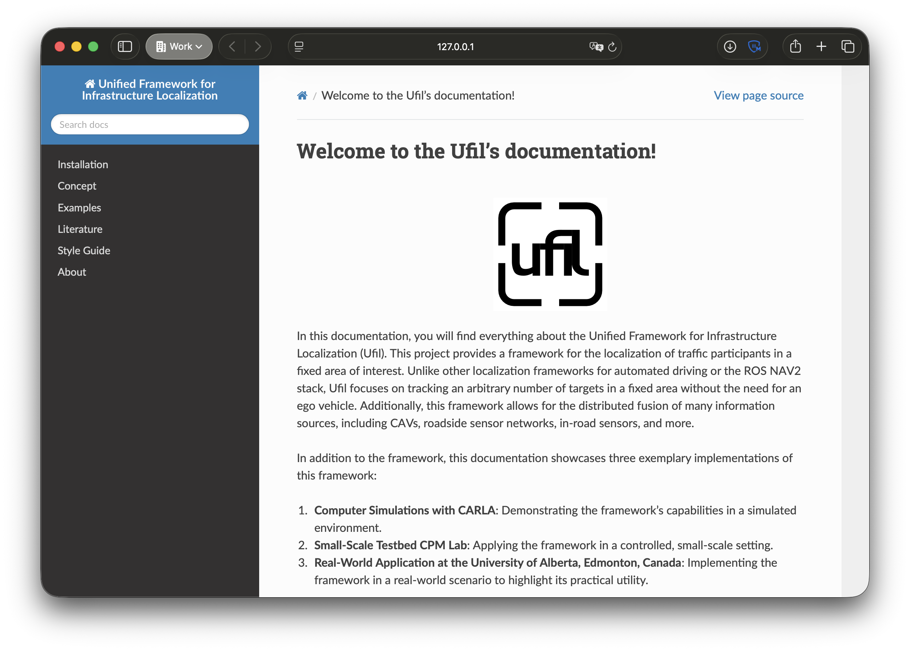

# 📚 Ufil Documentation

This repository contains the HTML-based [Sphinx](https://www.sphinx-doc.org/) documentation of the
Unified Framework for Infrastructure Localization (Ufil). By the end of this guide you can build
the documentation and view it in your browser:



Hosted versions:

- Public: [https://bassamlab.github.io/ufil-docs/](https://bassamlab.github.io/ufil-docs/) (mirror of the latest tag)
- Internal: [https://pages.unibw.de/documentation-1899cc](https://pages.unibw.de/documentation-1899cc) (default branch)

You can build, preview, and update the documentation easily using Visual Studio Code with a dev container.

## 🧰 Prerequisites

- [Docker](https://www.docker.com/) installed and running
- [Visual Studio Code](https://code.visualstudio.com/) installed
- [Dev Containers extension](https://marketplace.visualstudio.com/items?itemName=ms-vscode-remote.remote-containers) for VS Code

## 🚀 Getting Started

1. **Open the repository in VS Code**  
   Open this folder in VS Code using `File > Open Folder`.

2. **Reopen in Container**  
   When prompted by VS Code, click **"Reopen in Container"**.  
   If you're not prompted:
   - Open the Command Palette (`Ctrl+Shift+P` or `Cmd+Shift+P`)
   - Select: **Dev Containers: Reopen in Container**

   VS Code will now build and start the dev container with all dependencies pre-installed.

## ⚙️ Available Tasks

Once inside the container, you can use the following predefined VS Code tasks:

- **📄 Build HTML**  
  Builds the documentation with `sphinx-build -M html src _build`.
  - Run via Command Palette → `Tasks: Run Task` → **Build HTML**
  - Output is placed in the `_build/html` directory.

- **🌐 Start Webserver**  
  Serves the documentation at `http://localhost:8000` via `sphinx-autobuild`, rebuilding and reloading the browser on every save.
  - Run via Command Palette → `Tasks: Run Task` → **Start webserver**
  - Open `http://localhost:8000` (not `_build/html/index.html`) to receive live updates when you save source files, images, or styles.
  - Stop it with `Ctrl+C` in its terminal.

After updating dependencies, run **Dev Containers: Rebuild Container**. Without Docker, install
the same dependencies and start the live preview from the repository root:

```bash
python3 -m pip install -r .devcontainer/requirements.txt
sphinx-autobuild src _build/html --host 127.0.0.1 --port 8000
```

## 🐳 Build with Docker (without VS Code)

The dev container image can also be used directly to build or preview the documentation:

```bash
docker build -t ufil-docs .devcontainer
# Build once; -W turns warnings into errors (same as a clean CI build)
docker run --rm -v "$PWD":/docs -w /docs ufil-docs sphinx-build -M html src _build -W --keep-going
# Live preview at http://localhost:8000
docker run --rm -it -p 8000:8000 -v "$PWD":/docs -w /docs ufil-docs sphinx-autobuild src _build/html --host 0.0.0.0 --port 8000
```

Open `_build/html/index.html` after a build.

## 📎 Notes

- Images that still have to be created are SVG placeholders in `src/images/placeholders/` and are referenced as `placeholders/<name>_YYYYMMDD.*`. When adding a real image, use the date it is first committed in its filename and update the figure reference before deleting the placeholder.
- Custom styles (e.g. wrapping of table cells) live in `src/_static/custom.css`.
- Diagrams are written in [Mermaid](https://mermaid.js.org/) with the `.. mermaid::` directive of
  `sphinxcontrib-mermaid` (same setup as the CPM Lab documentation: Mermaid 12, ELK layout, redux
  theme). The diagrams are rendered in the browser, which loads Mermaid from `cdn.jsdelivr.net`.
  Wrap a diagram in `.. container:: mermaid-tall` so it keeps its aspect ratio instead of the fixed
  height of 500 px, and prefer `direction LR` inside subgraphs with edges between whole subgraphs,
  so long chains stay readable at page width.
- To add a Sphinx extension, add it to `.devcontainer/requirements.txt` *and* to `extensions` in `src/conf.py`, then rebuild the container. CI installs from the same file.

## 🌍 Public Mirror on GitHub

The internal GitLab repository is the source of truth. On every **tag**, the CI job
`sync-github-mirror` publishes a flattened snapshot to
[bassamlab/ufil-docs](https://github.com/bassamlab/ufil-docs), whose GitHub workflow
(`.github/workflows/docs-pages.yml`) builds it and deploys it to GitHub Pages. Do not commit to the
GitHub repository directly: every sync force-pushes over it.

Before pushing, the job turns the copy into the public version with `scripts/strip_internal.py`:

- it deletes every file or directory below `src/` whose name contains `uofa` (like the workspace mirror),
- it deletes every block between the comments `.. internal-only-begin` and `.. internal-only-end`,
- it activates every `.. public-only` block: the indented content below the marker is a comment
  in the internal documentation and becomes regular content in the public one.

Wrap links and toctree entries that point to internal-only pages, GitLab URLs and submodule
instructions in an internal-only block, and put the public replacement right after it:

```rst
.. internal-only-begin

.. code-block:: bash

   git clone --recurse-submodules ssh://git@git.unibw.de:2222/.../ufil-workspace.git ufil_ws

.. internal-only-end

.. public-only

   .. code-block:: bash

      git clone https://github.com/bassamlab/ufil.git ufil_ws
```

Markers may be indented, e.g. inside a numbered list; the content keeps the marker's indentation. The `test` job
builds both the internal documentation and the public snapshot with `-W -n`, so a missing marker
fails the pipeline before a tag is created. Check it locally with:

```bash
cp -r . /tmp/public-snapshot && python3 scripts/strip_internal.py /tmp/public-snapshot
sphinx-build -W --keep-going -n -b html /tmp/public-snapshot/src /tmp/public-snapshot/_build/html
```

Required CI/CD variables of the GitLab project: `GITHUB_MIRROR_DEPLOY_KEY` (private SSH key of a
GitHub deploy key with write access to `bassamlab/ufil-docs`). `GITHUB_MIRROR_URL` and
`GITHUB_MIRROR_BRANCH` are set in `.gitlab-ci.yml`.

## 🤝 Contributing

Feel free to submit pull requests or open issues for improvements or suggestions.

---

Happy documenting! ✨