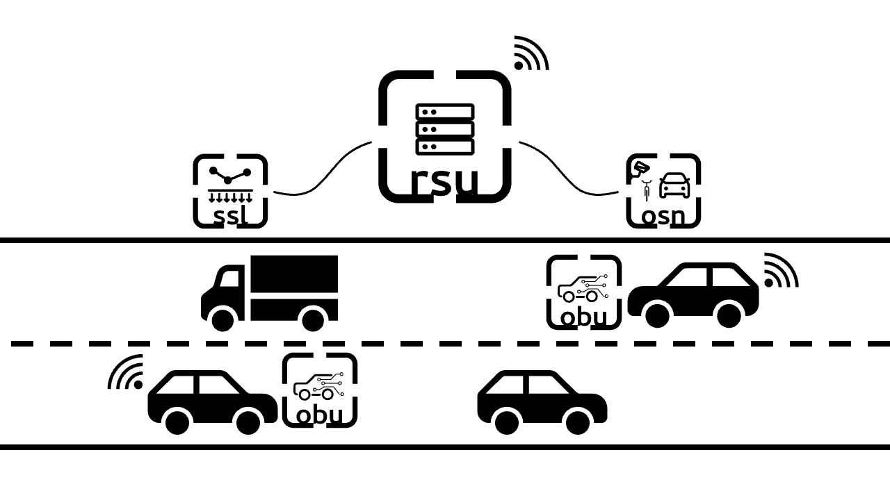
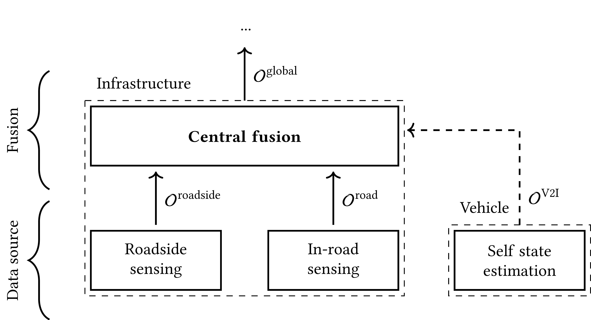
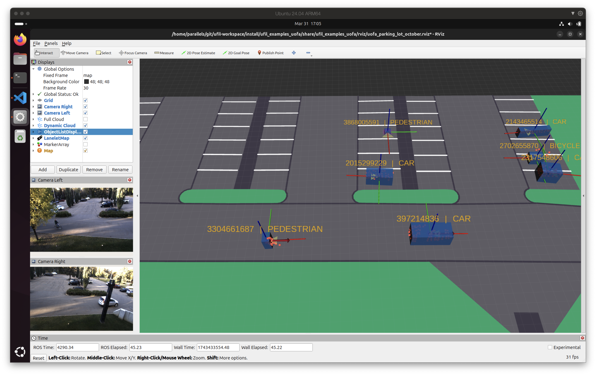

.. _concept:

Concept
=======

Ufil localizes and tracks all traffic participants in a fixed area of interest, such as an
intersection, a highway section or a parking lot. In contrast to localization stacks of automated
vehicles, it needs no ego vehicle: the infrastructure observes the scene, and vehicles that are
able to communicate contribute their own state.

Overview
--------

Ufil fuses object lists from several kinds of information sources. Three of them are supported
out of the box:

On-Board Unit (OBU)
   Runs in a connected vehicle. It estimates the vehicle's own state (GNSS, IMU, odometry) and
   broadcasts it as an ETSI ITS Cooperative Awareness Message (CAM) over V2X (UDP in Ufil).
Outdoor Sensor Node (OSN)
   A roadside pole with a lidar and optionally cameras. It detects and tracks all objects in its
   field of view and classifies them with the camera images.
Sensitive Surface Layer (SSL)
   A pressure-sensitive mat in the road surface. It detects wheel contacts, tracks the wheels and
   assembles them into vehicles.

All sources send their object lists to the **Road Side Unit (RSU)**, the fusion center at the
edge. The RSU decodes the received CAMs, fuses all sources into one global object list
(sensor-to-global fusion) and makes it available to other systems, e.g. via MQTT or OSC.

    Roadside sensing (OSN), in-road sensing (SSL) and the self state estimation of vehicles
    (OBU, via V2I) provide object lists :math:`O` to the central fusion of the infrastructure,
    which publishes the global object list.

.. container:: mermaid-tall

   .. mermaid::
      :caption: Ufil packages and the topics between them, as used in the examples
      :alt: Data flow from the OBU, OSN and SSL packages to the central fusion of the RSU, including the CAM path over UDP
      :align: center

      flowchart TB
         subgraph OBU["On-board unit (one per vehicle)"]
            direction LR
            ADP["Vehicle adapter or ufil_obu_object_aggregation"] -->|object| GEN["ufil_etsi CAM generator"] -->|cam| ENC["etsi_its_conversion CAM encoder"] -->|udp| SND["ufil_udp sender"]
         end
         subgraph OSN["Outdoor sensor node"]
            direction LR
            LIDAR[("Lidar")] -->|PointCloud2| PRE["ufil_pcl_preprocessor"] -->|dynamic_cloud| TRK["ufil_osn_tracker"] -->|object_list| CLS["ufil_osn_classifier (optional)"]
            CAMS[("Cameras")] -->|images| CLS
         end
         subgraph SSL["Sensitive surface layer"]
            direction LR
            MAT[("Pressure mats")] -->|OccupancyGrid| WT["ssl_wheel_tracker"] -->|wheel_tracks| VT["ssl_vehicle_tracking"]
         end
         subgraph RSU["Road side unit"]
            direction LR
            RCV["ufil_udp receiver"] -->|udp| DEC["etsi_its_conversion CAM decoder"] -->|cam| CR["ufil_etsi CAM receiver"] -->|"/rsu/cam/object_list"| CF["ufil_central_fusion"] -->|object_list_unfiltered| FLT["ufil_message_filter area of interest"]
         end
         OUT["ufil_visualization, ufil_mqtt, ufil_osc"]

         OBU ~~~ OSN ~~~ SSL
         OBU -. "CAM over UDP (V2X)" .-> RSU
         OSN -->|"/osn/object_list /osn/sensor_fov /osn/dynamic_occlusion_grid"| RSU
         SSL -->|"/ssl/object_list"| RSU
         RSU -->|"/rsu/object_list"| OUT

The following table shows the processing chain of each source as used in the examples:

.. list-table::
   :header-rows: 1
   :widths: 18 52 30

   * - Source
     - Processing chain
     - Output
   * - OBU
     - vehicle adapter → ``ufil_etsi`` (CAM generation) → ``etsi_its_conversion`` (encoding) →
       ``ufil_udp`` (sender)
     - CAM over UDP to the RSU
   * - OSN
     - ``ufil_pcl_preprocessor`` → ``ufil_osn_tracker`` (→ ``ufil_osn_classifier``)
     - ``/osn/object_list``, ``/osn/sensor_fov``, ``/osn/dynamic_occlusion_grid``
   * - SSL
     - ``ssl_wheel_tracker`` → ``ssl_vehicle_tracking``
     - ``/ssl/object_list``
   * - RSU
     - ``ufil_udp`` (receiver) → ``etsi_its_conversion`` (decoding) → ``ufil_etsi`` (CAM to objects);
       ``ufil_central_fusion`` (all sources) → ``ufil_message_filter`` (area of interest)
     - ``/rsu/object_list``; optionally forwarded with ``ufil_mqtt`` or ``ufil_osc``

Every traffic participant is represented as an *object*: a 2.5D bounding box with a pose, dynamic
state, dimensions, existence probability and classification (see :ref:`object_definition`).
Objects are exchanged as ``ufil_msgs/ObjectList`` messages (see :ref:`messages`) in a local
metric ``map`` frame or in UTM. An example of the tracks of an outdoor sensor node:

Design Principles
-----------------

**ROS-independent algorithms.** The tracking framework ``ufil_object_tracking`` is a header-only
C++20 library without any ROS 2 dependency. Every other package with an algorithm separates a
ROS-independent core library (``include/``, ``src/``) from a thin ROS 2 layer (``component/``)
that converts messages and parameters. The algorithms can therefore be unit-tested and reused
outside of ROS 2.

**Composable components.** Every node is an ``rclcpp`` component (e.g.
``ufil_osn_tracker::OsnTrackerNode``) from which a standalone executable is generated. Components
can be loaded into one container, e.g. the point cloud preprocessor and the tracker of the
outdoor sensor node share a process with intra-process communication.

**Uniform packages.** Each package provides ``config/default.yaml`` with its default parameters,
``launch/default.launch.xml`` to start it alone, diagnostics on ``/diagnostics`` and a
``CHANGELOG.rst``. Parameters are validated at start-up. See :ref:`style_guide`.

**Composable tracking.** Trackers are assembled from interchangeable building blocks: motion
models, distance measures, association algorithms, updaters and track management strategies
(see :ref:`tracking_pipeline`).

Terminology
-----------

* A **component** is an individual unit with a specific function, usually one ROS 2 node, e.g. the
  object list position filter.
* A **module** combines components to provide a higher-level function, e.g. the outdoor sensor
  node pipeline of preprocessor and tracker, or the CAM reception of the RSU.
* A **package** is a ROS 2 package; related packages are grouped in a directory below ``src/``
  (``ufil-core``, ``ufil-osn``, ...) with a meta package of the same name (``ufil_core``,
  ``ufil_osn``, ...).

..  toctree::
    :caption: Contents:
    :maxdepth: 2

    packages
    framework/notation
    framework/object_definition
    framework/messages
    tracking/tracking_pipeline
    updater/updater
    models/models
    hypothesize/hypothesize
    association/association
