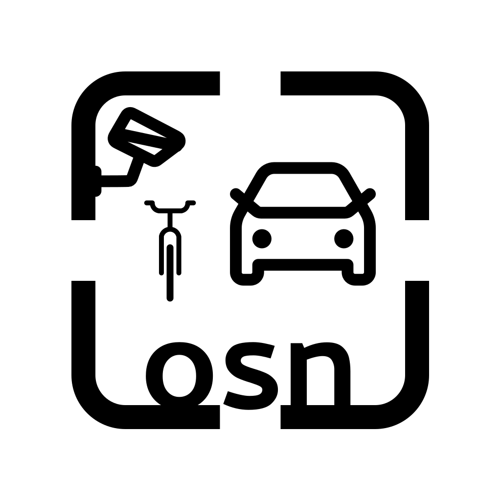
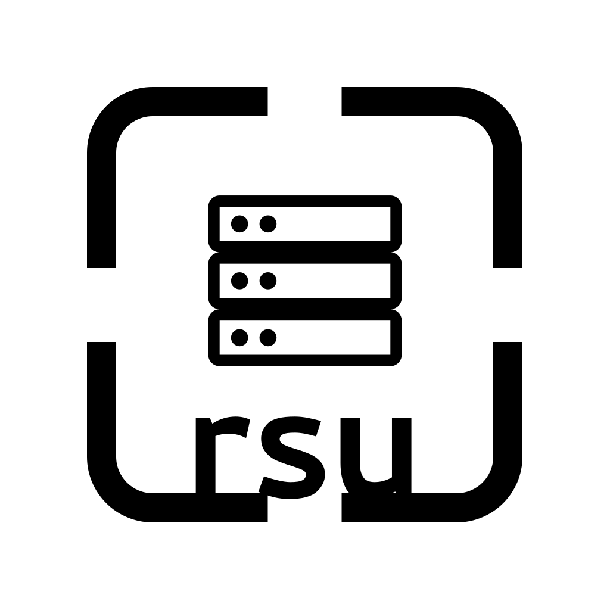
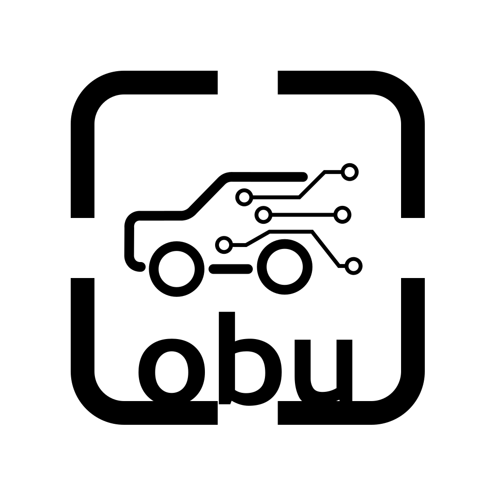

.. _packages:

Repositories and Packages
=========================

Ufil is split into seven components, each in its own directory below ``src/`` of the
workspace.

Every component contains a meta package that depends on all of its packages, so
``make <component>`` or ``colcon build --packages-up-to ufil_<component>`` builds a complete
component.

.. list-table::
   :header-rows: 1
   :widths: 20 20 60

   * - Component
     - Meta package
     - Content
   * - ``ufil-core``
     - ``ufil_core``
     - Tracking library, messages, ROS conversions, ETSI CAM handling, UDP/MQTT/OSC bridges,
       message filter, visualization
   * - ``ufil-osn``
     - ``ufil_osn``
     - Outdoor sensor node: point cloud preprocessing, lidar tracking, camera classification
   * - ``ufil-rsu``
     - ``ufil_rsu``
     - Road side unit: central fusion, CAM reception
   * - ``ufil-obu``
     - ``ufil_obu``
     - On-board unit: own-vehicle state estimation, CAM transmission
   * - ``ufil-ssl``
     - ``ufil_ssl``
     - Sensitive surface layer: mat simulator, wheel tracking, vehicle tracking
   * - ``ufil-tools``
     - ``ufil_tools``
     - Command line tools for bags (merge, trim, HDF5 export) and a landmark map builder
   * - ``ufil-examples``
     - ``ufil_examples``
     - Complete deployments: CARLA, CPM Lab, University of Alberta, pedestrian simulation
       (see :doc:`../examples/examples`)

All packages are released together (current version 0.2.0) and licensed under the MIT license.

.. note::
   Every node below is a composable component. The *executable* column gives the generated
   standalone executable for ``ros2 run``; components without an executable are loaded into a
   component container by their launch files. Topic names are relative to the node namespace.

.. _packages_core:

ufil-core
---------

.. list-table::
   :header-rows: 1
   :widths: 25 75

   * - Package
     - Description
   * - ``ufil_object_tracking``
     - Header-only, ROS-independent C++20 library for multi-object tracking: state, dimension,
       classification and existence types, transition and measurement models, distance measures,
       association, updaters, track management and point cloud detection. See
       :ref:`tracking_pipeline`.
   * - ``ufil_msgs``
     - Message definitions (see :ref:`messages`).
   * - ``ufil_ros``
     - Conversions between ``ufil_object_tracking`` types and ROS 2 messages (``ufil_msgs``,
       ``nav_msgs/OccupancyGrid``, ``sensor_msgs/PointCloud2``), ``tf2`` transforms of Ufil
       messages and JSON serialization of object lists and occupancy grids.
   * - ``ufil_etsi``
     - ETSI ITS Cooperative Awareness Messages (CAM, EN 302 637-2): generates the CAMs of a vehicle
       from its Ufil object (with the ETSI generation rules and the path history) and of a road
       side unit, and converts received vehicle CAMs back into Ufil objects.
   * - ``ufil_udp``
     - Bridge between ROS 2 and UDP, e.g. to exchange encoded ETSI messages.
   * - ``ufil_message_filter``
     - Forwards only the objects inside a polygonal area of interest.
   * - ``ufil_mqtt``
     - Forwards object lists or occupancy grids as JSON to an MQTT broker.
   * - ``ufil_osc``
     - Forwards object lists or occupancy grids as JSON in Open Sound Control (OSC) messages over UDP.
   * - ``ufil_visualization``
     - Converts Lanelet2 maps and object lists into ``visualization_msgs/MarkerArray`` for RViz,
       Foxglove or Lichtblick.
   * - ``ufil_viz_helpers``
     - Launch files for RViz 2 (``rviz.launch.xml``) and the Foxglove bridge
       (``foxglove-bridge.launch.xml``).

**Nodes**

.. list-table::
   :header-rows: 1
   :widths: 30 25 45

   * - Component
     - Executable
     - Interface
   * - ``ufil_etsi::VehicleCamGeneratorNode``
     - ``vehicle_cam_generator_node``
     - ``object`` (ObjectList, the vehicle is entry ``object_array_index``) → ``cam``
       (``etsi_its_cam_msgs/CAM``). The object is transformed into ``target_frame`` (a UTM frame)
       to compute the WGS84 position.
   * - ``ufil_etsi::VehicleCamReceiverNode``
     - ``vehicle_cam_receiver_node``
     - ``cam`` → ``object_list`` in ``target_frame``
   * - ``ufil_etsi::RsuCamGeneratorNode``
     - ``rsu_cam_generator_node``
     - Publishes the CAM of a road side unit at a fixed WGS84 ``position`` on ``cam``.
   * - ``ufil_udp::UdpSenderNode``
     - ``udp_sender_node``
     - ``udp_input`` (``udp_msgs/UdpPacket``) → datagrams to ``target_address:target_port``
   * - ``ufil_udp::UdpReceiverNode``
     - ``udp_receive_node``
     - datagrams on ``listen_port`` → ``udp_output``
   * - ``ufil_message_filter::ObjectListPositionFilterNode``
     - ``object_list_position_filter_node``
     - ``objects`` → ``objects_filtered``; ``area_of_interest.vertices`` ``[x1, y1, x2, y2, ...]``
       in the frame of the input lists, ``area_of_interest.enabled``
   * - ``ufil_mqtt::MqttMessageConverterNode``
     - ``mqtt_message_converter_node``
     - ``input`` → MQTT topic ``mqtt_topic`` at ``broker.host:broker.port``;
       ``message_type``: ``object_list`` or ``occupancy_grid``
   * - ``ufil_osc::OscMessageConverterNode``
     - ``osc_message_converter_node``
     - ``input`` → OSC address ``osc_address`` at ``receiver.host:receiver.port``
   * - ``ufil_visualization::ObjectListMarkerArrayNode``
     - ``object_list_marker_array_node``
     - ``object_list`` → ``object_markers`` (box, axes, velocity arrow, covariance ellipses, label)
   * - ``ufil_visualization::LaneletMapMarkerArrayNode``
     - ``lanelet_map_marker_array_node``
     - Lanelet2 OSM file ``map_path`` → ``map_markers`` in ``frame_id``

The CAM encoding and decoding (ASN.1 UPER) between ``etsi_its_cam_msgs/CAM`` and UDP payloads is
done by ``etsi_its_conversion`` of the external
`etsi_its_messages <https://github.com/ika-rwth-aachen/etsi_its_messages>`_ package. A complete
V2X link therefore consists of:

.. container:: mermaid-tall

   .. mermaid::
      :caption: CAM transmission from an on-board unit to the road side unit
      :alt: OBU nodes generate, encode and send the CAM over UDP; RSU nodes receive, decode and convert it into an object list
      :align: center

      flowchart TB
         OBJ(["object ufil_msgs/ObjectList"])
         subgraph OBU["On-board unit"]
            direction LR
            GEN["vehicle_cam_generator_node (ufil_etsi)"] -->|"cam"| ENC["cam_encoder (etsi_its_conversion)"] -->|"udp"| SND["udp_sender_node (ufil_udp)"]
         end
         subgraph RSU["Road side unit"]
            direction LR
            RCV["udp_receive_node (ufil_udp)"] -->|udp| DEC["cam_decoder (etsi_its_conversion)"] -->|cam| CR["vehicle_cam_receiver_node (ufil_etsi)"]
         end
         OUT(["object_list ufil_msgs/ObjectList"])

         OBJ --> OBU
         OBU -. "UDP, port 5000" .-> RSU
         RSU --> OUT

.. important::
   Sender and receiver must use the same ``time_shift_nanosec``: ETSI timestamps count from 2004,
   and the shift maps the ROS time onto that epoch (e.g. ``1104537600000000000`` for wall-clock
   time in the UofA example).

Forward the fused object list to an MQTT broker, e.g. for a dashboard:

.. code-block:: bash

   ros2 run ufil_mqtt mqtt_message_converter_node --ros-args \
     -r input:=/rsu/object_list -p broker.host:=localhost -p mqtt_topic:=ufil/object_list

.. _packages_osn:

ufil-osn
--------

The outdoor sensor node turns the point cloud of a roadside lidar into an object list.

.. list-table::
   :header-rows: 1
   :widths: 30 70

   * - Package / component
     - Description
   * - ``ufil_pcl_preprocessor``
       (``ufil_pcl_preprocessor::PclPreprocessorNode``)
     - Transforms ``input_cloud`` into ``target_frame``, applies a voxel filter, removes ground
       (``filter.z_min``/``z_max``) and outliers (``filter.outlier_radius``,
       ``filter.min_neighbors``), and removes static scene content given as boxes in
       ``static_object_file`` (CSV: ``x, y, z, yaw, length, width, height``). Publishes
       ``dynamic_cloud``, the estimated sensor field of view ``sensor_fov``
       (``ufil_msgs/SensorFOV``) and the occlusion grid of the static content
       ``dynamic_occlusion_grid``.
   * - ``ufil_osn_tracker``
       (``ufil_osn_tracker::OsnTrackerNode``)
     - Clusters ``dynamic_cloud`` into detections (Euclidean clustering, ``clustering.*``), fits
       oriented boxes and tracks them with an ``ufil_object_tracking`` multi-target tracker:
       extended constant velocity model, Euclidean distance with Hungarian association, Kalman
       filter and dimension grid map updates, an existence estimator and a classification derived
       from the estimated dimensions. The field of view (``sensor_fov``) and the occlusion grid
       (``dynamic_occlusion_grid``) let tracks survive occlusions. Publishes ``object_list`` and,
       for debugging, ``associated_measurements`` and ``unassociated_measurements``.
   * - ``ufil_osn_classifier`` (executable ``classifier``, Python)
     - Projects every track into the camera images, matches it with YOLO detections and fuses the
       camera classification with the tracker classification (``tracker_trust``,
       ``camera_trust``) with exponential smoothing (``smoothing_factor``). Publishes the classified
       list and annotated images. Uses ``models/yolo11s.engine`` (TensorRT) by default;
       set ``model_file`` to ``models/yolo11s.pt`` when TensorRT is not available.
   * - ``ufil_osn``
     - ``osn.launch.xml``: preprocessor and tracker in one component container with intra-process
       communication.

.. code-block:: bash

   ros2 launch ufil_osn osn.launch.xml input_topic:=/lidar/points use_sim_time:=true \
     pcl_preprocessor_params_file:=/path/to/overrides.yaml

The parameter files given to the launch file are loaded on top of the package defaults, so they
only need the values that differ (typically the frames, the static object file and the filter
limits).

.. _packages_rsu:

ufil-rsu
--------

.. list-table::
   :header-rows: 1
   :widths: 30 70

   * - Package / component
     - Description
   * - ``ufil_central_fusion``
       (``ufil_central_fusion::CentralFusionNode``, executable ``central_fusion_node``)
     - Fuses the object lists of any number of sensors into ``object_list`` in ``target_frame``.
   * - ``ufil_rsu``
     - ``central_fusion.launch.xml`` and ``cam.launch.xml`` (UDP reception, CAM decoding and
       conversion into an object list).

The central fusion follows a sensor-to-global strategy based on Aeberhard: every incoming object
list is associated with the global tracks (Euclidean distance, ``association.threshold``) and
updates them:

- **State**: Kalman filter with a random walk model for pedestrians and an extended constant
  velocity model for all other classes.
- **Existence**: Dempster-Shafer fusion with the sensor's field of view and occlusion
  (:doc:`updater/existence/existence_fusion`).
- **Classification**: Dempster-Shafer fusion with per-class trust
  (:doc:`updater/classification/classification_fusion`).
- **Dimension**: grid map fusion (:doc:`updater/dimension/dimension_fusion`).

Measurements are buffered for ``fusion.buffer_duration`` seconds. When data arrives that is older
than already fused data, the tracks are rolled back and the buffer is replayed in time order, so
the result does not depend on the arrival order of the sensors. A large jump of the timestamps
(e.g. a restarted recording) resets the fusion; implausible CAM timestamps are dropped instead.
Tracks are published every ``fusion.period`` seconds if their existence probability exceeds
``output.min_existence_probability``.

Sensors are configured by name:

.. code-block:: yaml

   /rsu/central_fusion:
     ros__parameters:
       target_frame: map
       sensor_names: [osn, cam]
       osn:
         topic: /osn/object_list
         fov_topic: /osn/sensor_fov                     # "" if the sensor has no field of view
         occlusion_topic: /osn/dynamic_occlusion_grid   # "" if the sensor has no occlusion grid
         is_cam: false
         trust: {existence: 0.7, car: 0.8, truck: 0.8, motorcycle: 0.8,
                 bicycle: 0.8, pedestrian: 0.8, stationary: 0.8, other: 0.8}
       cam:
         topic: /rsu/cam/object_list
         fov_topic: ""
         occlusion_topic: ""
         is_cam: true      # CAM objects do not initiate existence
         trust: {existence: 0.8, car: 0.8, truck: 0.8, motorcycle: 0.8,
                 bicycle: 0.8, pedestrian: 0.8, stationary: 0.8, other: 0.8}

.. list-table:: Further parameters (defaults)
   :header-rows: 1
   :widths: 40 15 45

   * - Parameter
     - Default
     - Meaning
   * - ``fusion.period``
     - 0.02
     - Fusion and publishing period [s]
   * - ``fusion.buffer_duration``
     - 2.0
     - Buffer for late arriving measurements [s]
   * - ``association.threshold``
     - 3.0
     - Maximum distance between track and measurement [m]
   * - ``existence.min_weight`` / ``max_weight``
     - 0.2 / 0.8
     - Clamp of the prediction weight :math:`\gamma`
   * - ``existence.decay_factor``
     - 0.05
     - Decay of the existence probability per missed update
   * - ``dimension.grid_resolution``
     - 0.1
     - Cell size of the dimension grid map [m]
   * - ``dimension.alpha``, ``p_min``, ``p_ref``, ``p_max``
     - 0.95, 0.1, 0.5, 0.9
     - Update factor and probability levels of the dimension grid map
   * - ``output.min_existence_probability``
     - 0.2
     - Minimum existence probability of published tracks

.. _packages_obu:

ufil-obu
--------

.. list-table::
   :header-rows: 1
   :widths: 30 70

   * - Package / component
     - Description
   * - ``ufil_obu_object_aggregation``
       (``ufil_obu_object_aggregation::ObjectAggregationNode``, executable ``object_aggregation_node``)
     - Combines the GNSS fix, the filtered odometry and the acceleration (time-synchronized) into
       the own vehicle as a Ufil object in UTM coordinates (``utm_zone``, ``-1`` selects the zone
       of the current position) and publishes it on ``object``. Size and class of the vehicle are
       parameters (``object.length``, ``object.width``, ``object.classification``).
   * - ``ufil_obu``
     - ``state_estimation.launch.xml``: ``robot_localization`` (EKF, navsat transform) and the
       object aggregation, fed by ``sensors/imu``, ``sensors/wheel`` and ``sensors/gps``.
       ``cam.launch.xml``: CAM generation, encoding and UDP transmission.

.. code-block:: bash

   ros2 launch ufil_obu state_estimation.launch.xml namespace:=obu \
     robot_localization_params_file:=/path/to/robot_localization.yaml \
     object_aggregation_params_file:=/path/to/vehicle.yaml
   ros2 launch ufil_obu cam.launch.xml namespace:=obu target_ip:=192.168.0.10

In the examples the vehicles' states come from adapters instead (CARLA ground truth, CPM Lab
indoor positioning, SBG INS of the UofA vehicle); they feed the same CAM chain.

.. _packages_ssl:

ufil-ssl
--------

The sensitive surface layer is a pressure-sensitive mat in the road surface. Its electronics
publish a pressure grid (``nav_msgs/OccupancyGrid``) per mat. All SSL packages are C++ components
with a ROS-independent core library.

.. list-table::
   :header-rows: 1
   :widths: 30 70

   * - Package / component
     - Description
   * - ``ssl_wheel_tracker``
       (``ssl_wheel_tracker::SslWheelTrackerNode``)
     - Detects wheel contacts as local pressure maxima (``detection.*``) in the grids of one or
       more mats (``input_topics``) and tracks them in ``tracking_frame`` with constant velocity
       Kalman filters, global nearest neighbour association (``tracking.gate_distance``) and
       multi-hit confirmation (``tracking.confirmation_hits``). Publishes ``wheel_detections`` and
       ``wheel_tracks``.
   * - ``ssl_vehicle_tracking``
       (``ssl_vehicle_tracking::SslVehicleTrackingNode``)
     - Assembles vehicles from ``wheel_tracks`` by fitting vehicle templates (wheel layouts from
       JSON files, ``vehicle_templates``), evaluates the wheel assignment and the existence of every
       vehicle frame by frame and publishes ``vehicles`` (ObjectList, including the axle topology).
       Templates shipped: ``car_carla``, ``truck_carla``, ``motorcycle_carla``, ``muCar_lab``,
       ``muCar_scaled_lab``.
   * - ``ssl_simulator``
       (``ssl_simulator::SslSimulatorNode``)
     - Virtual mat: extrapolates the vehicles of an ``object_list`` to the frame time and rasterizes
       the contact patches of their wheels into a pressure grid ``ssl_<node_id>/map``, including
       line crosstalk, sensor noise and the threshold of the mat electronics. Pose and size of the
       mat are parameters (``x``, ``y``, ``heading``, ``width``, ``height``, ``resolution``).
   * - ``ssl_vehicle_tracking_msgs``
     - Internal wheel and track messages between the two trackers.
   * - ``ufil_ssl``
     - Launch files ``wheel_tracker.launch.xml``, ``vehicle_tracking.launch.xml`` and
       ``simulation.launch.xml``.

The SSL is described in detail in :doc:`../literature` (Schäfer et al., IV 2023).

.. _packages_tools:

ufil-tools
----------

.. list-table::
   :header-rows: 1
   :widths: 25 20 55

   * - Package
     - Kind
     - Usage
   * - ``ufil_bag_manipulator``
     - command line tool
     - ``ufil_bag_manipulator merge BAG1 BAG2 [...] -o OUT`` merges bags ordered by receive time;
       ``ufil_bag_manipulator trim BAG -o OUT --trim SECONDS [--keep-timestamps]`` drops the start of
       a bag and shifts the timestamps to zero. Messages are copied without deserialization.
   * - ``ufil_hdf_converter``
     - command line tool
     - ``ufil_hdf_converter BAG [-o OUT.hdf5 | -k KEY] [-t TOPIC ...] [-f]`` converts a bag into an
       HDF5 file following the SFB data handbook (IMU, magnetic field, GNSS, odometry, point clouds,
       occupancy grids, TF and Ufil object lists).
   * - ``ufil_pcl_map_builder``
     - ROS 2 node
     - ``ros2 launch ufil_pcl_map_builder default.launch.xml`` stores every point published with the
       RViz *Publish Point* tool as a typed node (``point_types``: curb, tree, sign, ...) of a
       Lanelet2 OSM file georeferenced at ``origin``. Switch the type of the next point with
       ``ros2 param set /pcl_map_builder point_type tree`` or the number keys.

The command line tools are on the ``PATH`` after ``source install/setup.bash``; they are started
directly (not with ``ros2 run``), need no running ROS graph and print all options with ``--help``.

.. code-block:: bash

   # Merge the recordings of two machines and export the result for the evaluation
   ufil_bag_manipulator merge head_bag headless_bag -o merged_bag
   ufil_hdf_converter merged_bag -o merged.hdf5 -t /rsu/object_list /osn/object_list

Evaluation Scripts
------------------

The ``evaluation/`` directory of the workspace contains Python scripts that evaluate recorded
tracker outputs (converted to HDF5 with ``ufil_hdf_converter``): they interpolate and filter the
tracks, compute position and dimension errors and plot the results. ``evaluation/config.yml``
configures the frame transformation, the preprocessing and the thresholds. The data under
``evaluation/bags`` holds runs of a crossing scenario for every combination of distance measure
(Euclidean, Mahalanobis, Wasserstein) and association algorithm (greedy, Hungarian,
Jonker-Volgenant, LP solver).
