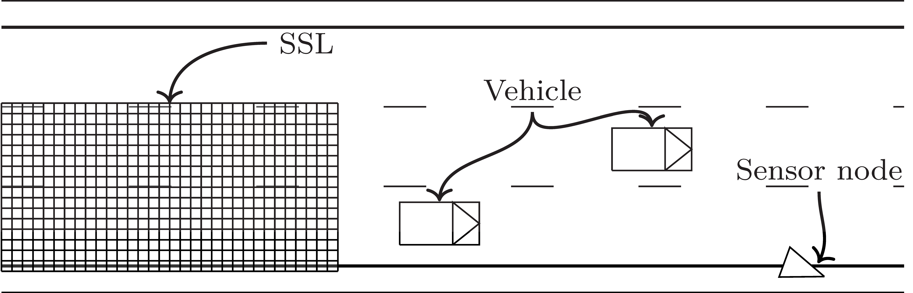
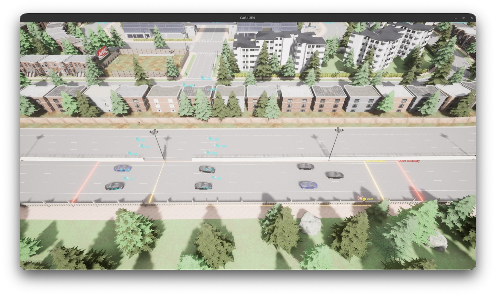
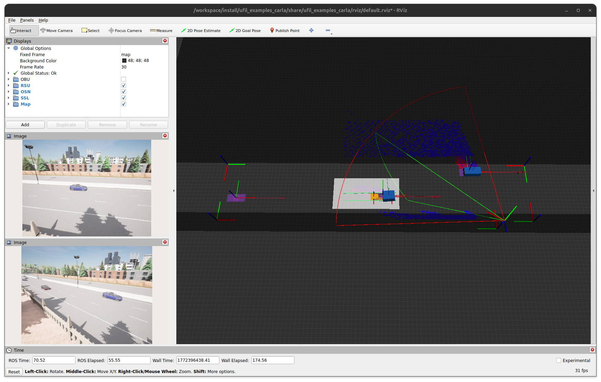

.. _examples_carla:

CARLA
=====

This example runs the complete Ufil pipeline on synthetic traffic from the CARLA simulator [1].
The simulator and the CARLA ROS bridge run in Docker containers based on CARLOS [2]; the Ufil
side runs on the ROS 2 data of the bridge:

- **OBU**: ``ufil_examples_carla_adapter`` converts the ground-truth objects of the bridge
  (``/carla/objects``, ``/carla/actor_list``) into Ufil object lists in ``/obu``, including the
  axle geometry of the known vehicle blueprints. The vehicles 0 to 6 of that list each get an
  on-board unit (namespaces ``/obu_0`` to ``/obu_6``) that sends their state as CAM over UDP.
- **OSN**: a lidar on a 6.5 m pole (``/carla/lidar``) feeds the point cloud preprocessor and the
  OSN tracker.
- **SSL**: a virtual mat (``ssl_simulator``) rasterizes the wheels of the ground-truth objects into
  a pressure grid, which is processed by the SSL wheel and vehicle trackers with the CARLA
  vehicle templates.
- **RSU**: receives the CAMs, fuses OSN, SSL and CAM objects and publishes ``/rsu/object_list``,
  limited to the area of interest.

    The highway scenario: the SSL covers the lanes upstream, the outdoor sensor node is installed downstream facing the SSL region, and vehicles broadcast CAMs. The fields of view partially overlap.

    The highway scenario in CARLA (Town05).

    Ufil tracking the CARLA highway scenario, replayed from a recorded bag.

Packages: ``ufil_examples_carla`` (launch files, configuration, URDF, simulator setup),
``ufil_examples_carla_adapter`` and ``carla_msgs`` (messages of the CARLA ROS bridge).

Scenarios
---------

Both scenarios run CARLA in synchronous mode (``fixed_delta_seconds`` 0.05 s) with the bridge
publishing ``/clock``. A traffic manager keeps 15 vehicles (Tesla Model 3) driving and respawns
them.

.. list-table::
   :header-rows: 1

   * - Scenario
     - Town
     - Area of interest
     - Sensor pole
   * - ``highway``
     - `Town05 <https://carla.readthedocs.io/en/latest/map_town05/>`_ (``Town05_Opt``)
     - one-way stretch of a highway
     - ``(219.0, 70.0)``, 6.5 m
   * - ``intersection``
     - `Town10 <https://carla.readthedocs.io/en/latest/map_town10/>`_ (``Town10HD_Opt``)
     - three-way intersection
     - ``(-58.8, -145.5)``, 6.5 m

Each scenario has its own parameter file ``config/carla-<scenario>.yaml`` (area filter, static
objects of the OSN, SSL mat pose, fusion sensors) and URDF ``urdf/<scenario>.urdf.xml``.

Launch Files
------------

.. list-table::
   :header-rows: 1
   :widths: 40 60

   * - Launch file
     - Content
   * - ``carla-<scenario>_head.launch.xml``
     - CARLA adapter with area filter (``/obu``), CAM senders of the vehicles 0 to 6 to the RSU at
       ``192.168.1.41`` and the visualization nodes.
   * - ``carla-<scenario>_headless.launch.xml``
     - OSN, SSL (wheel and vehicle tracking of ``/ssl/ssl_1/map``) and RSU with CAM reception,
       central fusion and area filter.
   * - ``carla-<scenario>.launch.xml``
     - Head and headless on one machine; the CAMs are sent to ``127.0.0.1``.
   * - ``carla-<scenario>_simulation.launch.xml``
     - Simulated sensors: CARLA adapter with area filter and the virtual SSL mat fed with the
       CARLA objects (publishes ``/ssl/ssl_1/map``), with visualization. Run it next to the
       simulator when recording bags.

Run with Recorded Bags
----------------------

Bags of the simulation contain the CARLA topics and the simulated SSL grid, so no simulator is
needed. Start the processing stack and replay the bag with its clock:

.. code-block:: bash

   ros2 launch ufil_examples_carla carla-highway.launch.xml

.. code-block:: bash

   ros2 bag play ./260223_highway/ --clock 300 --topics /carla/lidar /ssl/ssl_1/map \
     /ssl/ssl_1/map_update /carla/objects /carla/actor_list \
     /carla/rgb_view_left/image /carla/rgb_view_right/image

Restricting the replay to the sensor topics avoids duplicates of the topics that the launched
stack publishes itself. A higher clock frequency (``--clock 300``) improves the timestamp accuracy.

With Docker Compose (``use_sim_time`` is ``false`` in the compose services, so replay the bag
without depending on ``/clock`` or launch from the ``terminal`` profile):

.. code-block:: bash

   BAG=/absolute/path/to/bag COMPOSE_PROFILES=carla-highway,bag,foxglove-bridge docker compose up

Run with the Live Simulator
---------------------------

CARLA needs an NVIDIA GPU with the NVIDIA container runtime. The simulator setup of each scenario
lives in

- ``src/ufil-examples/carla/ufil_examples_carla/simulator/highway``
- ``src/ufil-examples/carla/ufil_examples_carla/simulator/intersection``

1. Start the CARLA server, the ROS bridge and the traffic manager from the scenario directory:

   .. code-block:: bash

      cd src/ufil-examples/carla/ufil_examples_carla/simulator/highway
      docker compose -f docker-compose.offscreen.yml up

   ``docker-compose.yml`` renders on screen instead and additionally starts a debug client that
   draws the sensor positions and the area of interest in the simulator, which helps when
   adjusting a scenario.

2. Start the simulated sensors and the Ufil stack:

   .. code-block:: bash

      ros2 launch ufil_examples_carla carla-highway_simulation.launch.xml

   .. code-block:: bash

      ros2 launch ufil_examples_carla carla-highway_headless.launch.xml

   ``carla-highway_head.launch.xml`` is optional and adds the on-board units, which send the CAMs
   of the vehicles to the RSU, for a distributed setup on a second machine.

.. important::
   The simulator containers use host networking with Fast DDS on ``ROS_DOMAIN_ID=42``. The Ufil
   nodes must use the same middleware and domain to receive the CARLA topics, e.g.
   ``RMW_IMPLEMENTATION=rmw_fastrtps_cpp ROS_DOMAIN_ID=42`` (see :ref:`usage_middleware`).

Use the ``carla-intersection_*`` launch files and the ``intersection`` directory for the
intersection scenario.

Dataset
-------

The dataset used for this example is currently **redacted** and will be made available after the
paper is accepted at the corresponding venue.

References
----------

| [1] `CARLA: An Open Urban Driving Simulator <https://proceedings.mlr.press/v78/dosovitskiy17a/dosovitskiy17a.pdf>`_, A. Dosovitskiy et al. 2017
| [2] `CARLOS: An Open, Modular, and Scalable Simulation Framework for the Development and Testing of Software for C-ITS <https://arxiv.org/abs/2404.01836>`_, C. Geller et al. 2024
