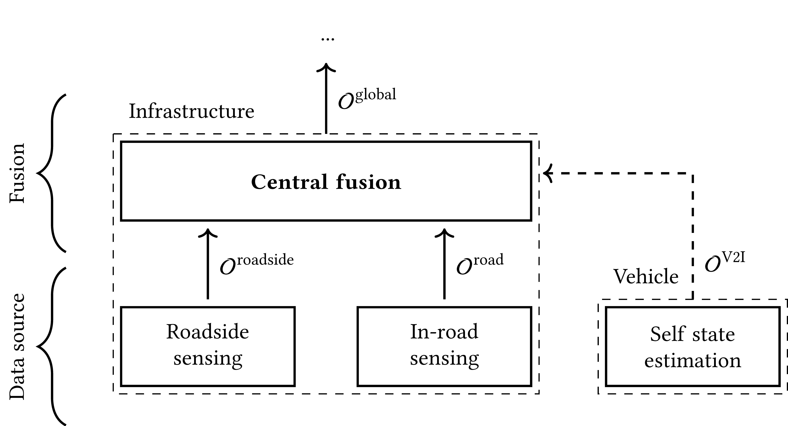

.. _complex_scenario:

Complex Scenario: Full System
=============================

The CARLA and CPM Lab examples implement the same *complex scenario*: a fully fledged
infrastructure-based perception system that uses all components of Ufil. A single road section
is observed by in-road sensing with ``ufil_ssl``, a lidar sensor node at the side of the road with
``ufil_osn``, and several vehicles with V2X communication via ``ufil_obu``. The scenario is
designed to be as close as possible to a real-world deployment. This page describes how the
components work together; :doc:`../concept/packages` lists their interfaces and parameters.

   Data sources and central fusion of the complex scenario.

Sensitive Surface Layer (``ufil_ssl``)
--------------------------------------

The SSL pipeline converts raw load measurements into an object list in the map frame. It
subscribes to the pressure grid of each mat (``nav_msgs/OccupancyGrid``) and applies a three-stage
processing chain: wheel detection, wheel tracking and vehicle identification.

- **Wheel detection** extracts local maxima in each pressure map and computes intensity-weighted
  centroids around each maximum, so that wheel positions are robust to overlapping contact
  patches and the grid discretization.
- **Wheel tracking** uses Kalman filters with a constant velocity model and nearest neighbour
  association to maintain continuous wheel trajectories, including track confirmation and
  deletion.
- **Vehicle identification** groups wheel tracks into rigid-body hypotheses using axle and wheel
  templates, checks their geometric consistency (track width, axle spacing, velocity coherence)
  and computes a vehicle existence from per-wheel quality measures and the number of assigned
  wheels.

The vehicles are published as ``ufil_msgs/ObjectList`` with state and covariance, approximate
dimensions, a classification vector, the axle topology (track widths and center-to-axle
distances) and an existence probability.

Lidar-based Outdoor Sensor Node (``ufil_osn``)
----------------------------------------------

The outdoor sensor node performs point cloud preprocessing, object detection, tracking, dimension
estimation, classification and existence estimation for a static roadside lidar.

- **Preprocessing** transforms the point cloud from the sensor frame into a ground-aligned base
  frame, removes the ground and known static structures with height and crop-box filters, and
  downsamples it with a voxel filter while preserving the object shapes.
- **Detection** clusters the filtered point cloud (Euclidean clustering) and fits oriented
  bounding boxes: L-shape fitting for extended objects, a cylindrical model for small or
  approximately circular objects.
- **Tracking** predicts and updates position, velocity, yaw and yaw rate with a Kalman filter and
  a planar motion model. The association works in two stages: first by the overlap with the
  predicted boxes, then by distance for the remaining detections.
- **Dimensions** are estimated with a one-dimensional grid map per axis; every box measurement is
  integrated with a variance-aware binary Bayes update with forgetting
  (:doc:`../concept/updater/dimension/dimension_fusion`).
- **Classification** is computed from the estimated dimensions with class-conditioned normal
  distributions and Bayes' rule
  (:doc:`../concept/updater/classification/classification_estimation_via_look_up`).
- **Existence** is estimated from the track's age, association ratio, shape stability and motion
  consistency, taking the sensor field of view and occlusions into account.

The node publishes ``ufil_msgs/ObjectList`` in the map frame with state, covariance, dimensions
with covariance, classification vector and existence probability.

On-Board Unit and V2I (``ufil_obu``)
------------------------------------

The on-board unit converts the self-state estimate of a vehicle into V2I messages. It receives the
vehicle's state (e.g. a fused GNSS/inertial pose and velocity) and dimensions, transforms the
position between WGS84, UTM and the local map frame, and fills a Ufil object with state, covariance
and dimensions. This object is mapped to an ETSI CAM (position, speed, heading and dimensions as
far as the CAM data model supports them) and sent over UDP to the RSU.

Locally, the OBU publishes the object as ``ufil_msgs/ObjectList`` for other ROS 2 components; the
classification vector is then a one-hot encoding of the known vehicle class and the existence
probability is 1.0. The resolution limits of the CAM fields and the characteristics of the
vehicle's state estimator are reflected in the covariance attached to the object and propagated
through the fusion.

Central Fusion on the RSU
-------------------------

The central fusion subscribes to the object lists of ``ufil_ssl``, ``ufil_osn`` and the received
CAMs and fuses them into one global object list in the map frame. It follows the multi-object
tracking cycle: prediction of all global tracks to the fusion time, association of the incoming
sensor objects with the global tracks, update of state, dimensions, classification and existence,
and management of track births and deletions.

- **Out-of-sequence data**: the RSU buffers the incoming messages over a configurable horizon and
  processes them in chronological order before predicting the fused state to the publish time.
- **State**: dynamic measurement models use only the state components that a source actually
  provides (the others are masked in the covariance) in a Kalman update with a class-dependent
  motion model (random walk for pedestrians, extended constant velocity otherwise).
- **Dimensions** are fused with the same grid map estimator as on the sensor node, so that
  measurements from different modalities with different uncertainties form a consistent estimate.
- **Classification** is fused with Dempster-Shafer theory over a reduced powerset of fine-grained
  classes and superclasses (vehicle, VRU, stationary) with sensor-specific trust values
  (:doc:`../concept/updater/classification/classification_fusion`).
- **Existence** is fused with Dempster-Shafer theory as well, combining persistence (field of view
  and occlusion), per-sensor trust and the association history; thresholds control the
  publication and deletion of tracks (:doc:`../concept/updater/existence/existence_fusion`).

The fusion loop is time-triggered (50 Hz by default) and publishes ``ufil_msgs/ObjectList``: a
unified, uncertainty-aware description of all tracked road users, suitable as input for
downstream digital-twin and traffic-management components.

Implementations
---------------

Two examples implement the complex scenario: :doc:`CARLA <carla/carla>` generates synthetic sensor
data with a high-fidelity simulator, and the :doc:`CPM Lab <cpm_lab/cpm_lab>` uses real data from
a small-scale testbed.
