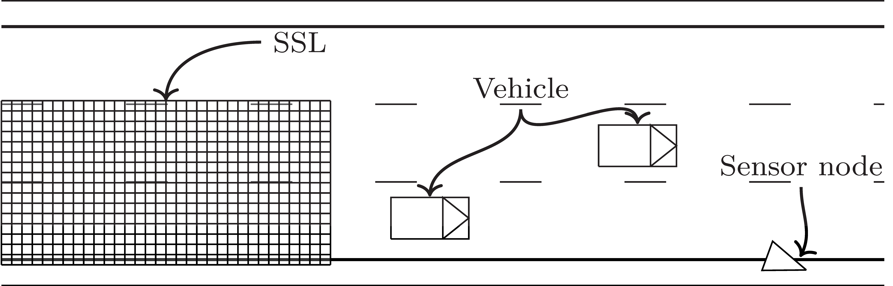
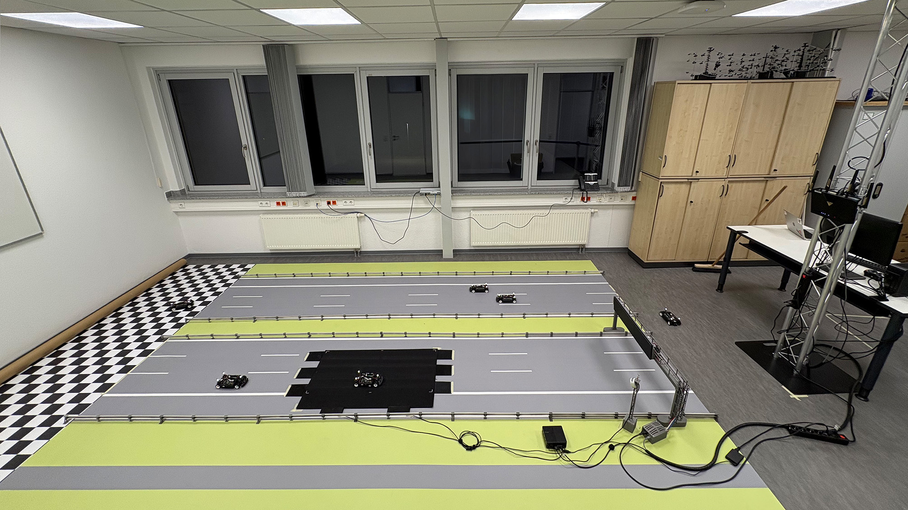
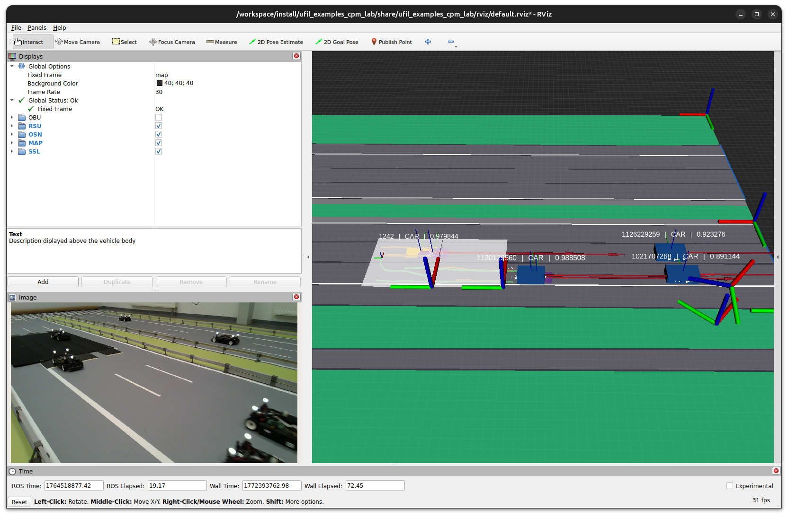

.. _examples_cpm_lab:

Cyber-Physical Mobility Lab (CPM Lab)
=====================================

The `CPM Lab <https://cpm.embedded.rwth-aachen.de/>`_ at RWTH Aachen University is a small-scale
testbed with networked 1:18 model vehicles (µCars) and an indoor positioning system. In this
example, the lab hosts a scaled version of the Ufil demonstrator: lab vehicles act as connected
vehicles, a depth camera on a pole acts as outdoor sensor node, and two pressure-sensitive mats
form the sensitive surface layer. All objects are scaled to real-world dimensions, so the same
components and parameters as in a full-scale deployment can be used.

    The scenario: a three-lane highway segment with an SSL covering the two right-most lanes upstream and a roadside outdoor sensor node downstream facing the SSL region. Their fields of view partially overlap; the vehicles broadcast CAMs.

    The setup in the CPM Lab: µCars on the highway segment, the SSL mats and the sensor pole.

    Ufil tracking the vehicles of the CPM Lab scenario, replayed from a recorded dataset.

- **OBU**: ``ufil_examples_cpm_lab_adapter`` subscribes to the states of the lab vehicles
  12, 13, 15, 17, 18 and 19 (``/lab/vehicle_<id>/vehicleState``), scales them by 18 and
  publishes them in the ``map`` frame: all vehicles together on ``/obu/object_list`` and each one
  alone on ``/obu/vehicle_<id>/object_list``. Every vehicle has an on-board unit (namespace
  ``/obu_<id>``) that sends its CAM over UDP.
- **OSN**: an Intel RealSense L515 on a pole (``/l515/depth/color/points``) feeds the point cloud
  preprocessor and the OSN tracker. The static lab infrastructure is removed with
  ``config/sfb_demonstrator.csv``.
- **SSL**: two mats (``/ssl_1``, ``/ssl_2``) are tracked together by the SSL wheel tracker; the
  vehicle tracking uses the template of the scaled µCar (``muCar_scaled_lab.json``).
- **RSU**: receives the CAMs and fuses CAM, OSN and SSL objects into ``/rsu/object_list``,
  limited to the lab area.

The visualization shows the Lanelet2 map ``maps/A61 Lanelet2.osm`` of the demonstrator.

Packages
--------

.. list-table::
   :header-rows: 1
   :widths: 35 65

   * - Package
     - Content
   * - ``ufil_examples_cpm_lab``
     - Launch files, ``config/cpm-lab.yaml``, URDF and Lanelet2 map
   * - ``ufil_examples_cpm_lab_adapter``
     - ``CpmLabAdapterNode`` (lab vehicles → Ufil object lists), ``CpmLabSensorNode`` (simulated
       GNSS, IMU and wheel odometry of a lab vehicle, e.g. to feed the :ref:`OBU state estimation
       <packages_obu>`) and ``OscLaneControlLightNode`` (forwards lane control lights as JSON in
       OSC messages)
   * - ``cpm_lab_lab_msgs``, ``cpm_lab_map_msgs``
     - Wire-compatible copies of the CPM Lab interfaces (vehicle states and commands, indoor
       positioning, binary Lanelet2 maps, lane control lights)

The adapter is configured in ``config/cpm-lab.yaml``:

.. code-block:: yaml

   /obu/cpm_lab_adapter:
     ros__parameters:
       vehicle_ids: [12, 13, 15, 17, 18, 19]
       target_frame: map
       # defaults: vehicle_state_topic /lab/vehicle_{id}/vehicleState, source_frame lab,
       #           publish_rate 20.0 Hz, state_timeout 0.5 s

Running the Example
-------------------

**Live in the lab.** The CPM Lab software publishes the vehicle states and the mats publish their
pressure grids. Start the head part on the machine connected to the lab network and the
headless part on the infrastructure machine (``192.168.1.41`` receives the CAMs on port 5000):

.. code-block:: bash

   ros2 launch ufil_examples_cpm_lab cpm-lab_head.launch.xml use_sim_time:=false

.. code-block:: bash

   ros2 launch ufil_examples_cpm_lab cpm-lab_headless.launch.xml use_sim_time:=false

With Docker Compose, use the profiles ``cpm-lab-head`` and ``cpm-lab-headless`` (see
:ref:`usage_distributed`).

**On one machine**, e.g. with a recorded bag:

.. code-block:: bash

   ros2 launch ufil_examples_cpm_lab cpm-lab.launch.xml

.. code-block:: bash

   ros2 bag play <bag-folder> --clock 300

A higher clock frequency (``--clock 300``) improves the timestamp accuracy.

or with Docker Compose:

.. code-block:: bash

   BAG=/absolute/path/to/bag COMPOSE_PROFILES=cpm-lab,bag,foxglove-bridge docker compose up

Dataset
-------

The dataset used for this example is currently **redacted** and will be made available after the
paper is accepted at the corresponding venue.

Topics
------

.. list-table::
   :header-rows: 1
   :widths: 40 60

   * - Topic
     - Content
   * - ``/obu/object_list``
     - All lab vehicles inside the lab area (ground truth of the indoor positioning)
   * - ``/osn/object_list``
     - Tracks of the outdoor sensor node
   * - ``/ssl/object_list``
     - Vehicles detected by the two SSL mats
   * - ``/rsu/cam/object_list``
     - Objects decoded from the received CAMs
   * - ``/rsu/object_list``
     - Fused object list
   * - ``/map``, ``/<source>/object_markers``
     - Visualization markers
